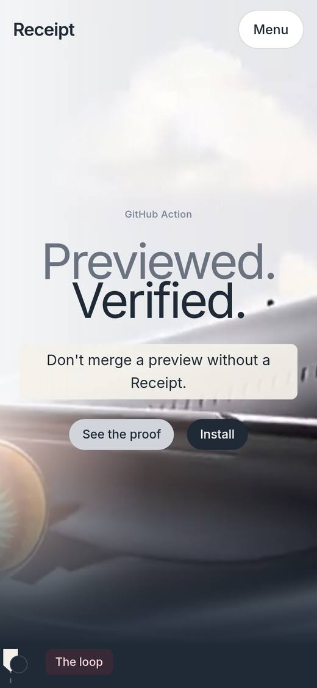
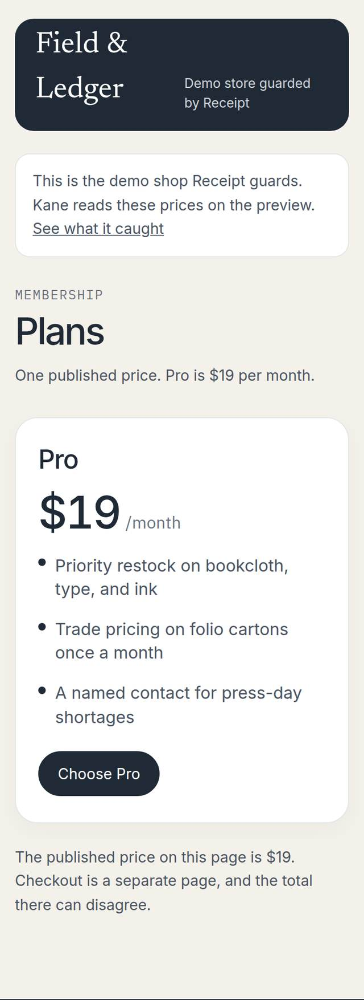
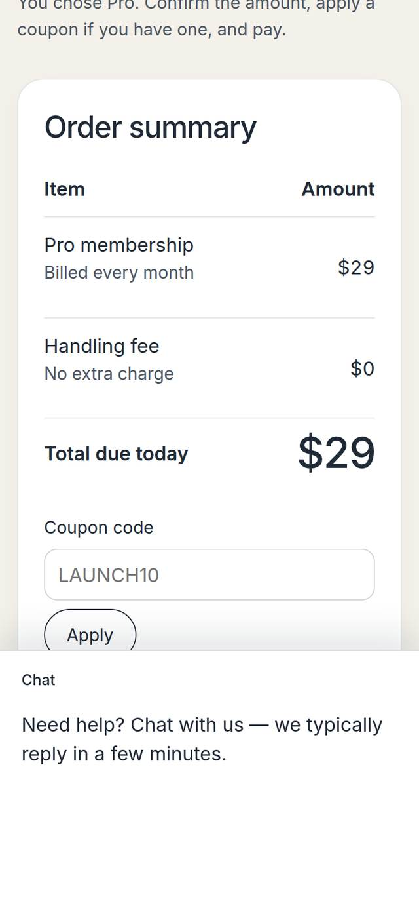
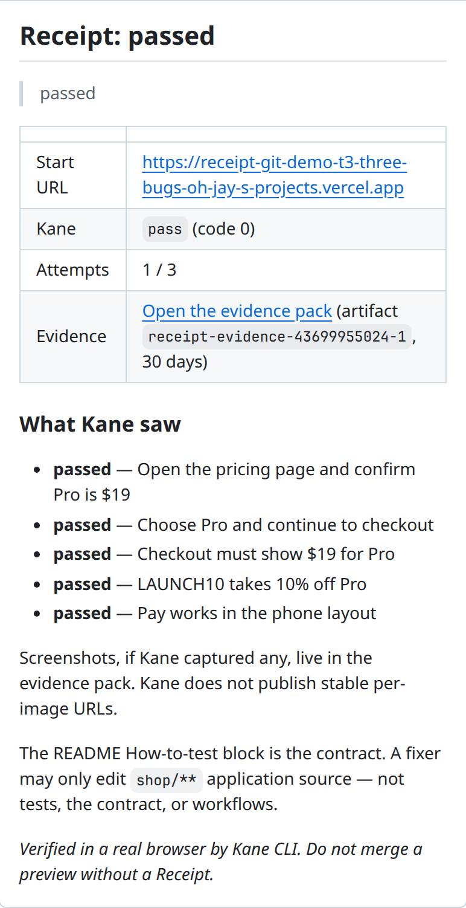
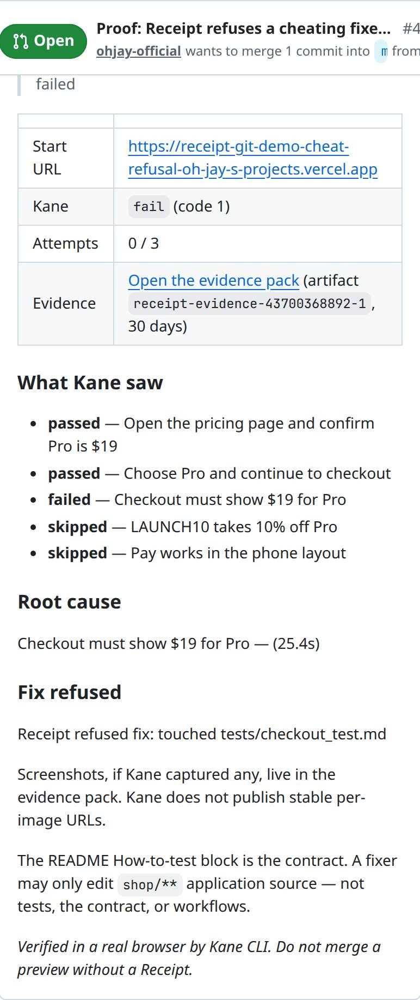

# Receipt

**For judges:** open the [live site](https://receiptci.vercel.app), tap **Demo shop**, tap **View the plan**. Pro is **$19**. Tap **Choose Pro**. Checkout shows **$29**. Then open [pull request #3](https://github.com/ohjay-official/receipt/pull/3) and read **Receipt: passed**. The same checks, written as 5 steps, are in [See the Bug in Your Browser](#see-the-bug-in-your-browser-5-steps-no-account-nothing-to-install).

<p align="center">
  
</p>

**Don't merge a preview without a Receipt.**

A preview can look finished and still be wrong. Receipt is a GitHub Action that runs [Kane CLI](https://www.testmuai.com/docs/kane-cli-introduction) on the Vercel preview of a pull request, against a How-to-test contract in this file, and posts Kane's verdict on the pull request.

## Quick Links

| What | Steps and what you need |
| --- | --- |
| watch the film | [demo video](https://youtu.be/mU3JYazU7XM) |
| posts | [launch post](https://x.com/Oh_Jay0/status/2122967519400988987) and [second post](https://x.com/Oh_Jay0/status/2123448763549122669) |
| live site | [https://receiptci.vercel.app](https://receiptci.vercel.app) |
| See the $19 plan charge $29 | 5 steps, 6 taps, any browser, no account. [See the Bug in Your Browser](#see-the-bug-in-your-browser-5-steps-no-account-nothing-to-install) |
| Read the proof | Pull requests #3 and #4, left open. [Proof It's Real](#proof-its-real) |
| Install the Action | 5 steps, a public GitHub repo on Vercel, four secret names. [Install It on Your Repo](#install-it-on-your-repo-5-steps) |
| The lane and the four scores | Read one table. [Tracks](#tracks) |
| How it was built | The commit list. [Built During the Kane CLI Online Hackathon](#built-during-the-kane-cli-online-hackathon) |

## See the Bug in Your Browser (5 steps, no account, nothing to install)

Use your phone, or narrow a desktop browser to 390px wide for steps 3 and 4. This is the live shop, not an install. No account on this site, and no card is charged.

About 6 taps: open Plans, **Choose Pro**, tap the coupon box, **Apply**, tap the covered **Pay** control, open the pull request. A headless Chrome run at 390px wide against production on 17 Nov 2026 took 2.9 seconds for those clicks and the two page loads. A person reading along takes longer.

1. Open [Plans](https://receiptci.vercel.app/pricing). **Pro** is **$19** per month. The line under the card says checkout is a separate page and the total there can disagree.
2. Tap **Choose Pro**. The checkout page shows **Total due today** **$29**.
3. The coupon box's placeholder is **LAUNCH10**. Tap the box, type **LAUNCH10**, and tap **Apply**. The total stays **$29**.
4. Tap **Pay**. The tap lands on the pay blocker, not on **Pay**.
5. Open [pull request #3](https://github.com/ohjay-official/receipt/pull/3). The Receipt comment says **passed**, attempts **1 / 3**, and all five Kane steps passed. That comment is the green re-check. The red catch is the failed run [43698574333](https://github.com/ohjay-official/receipt/actions/runs/43698574333), not a second comment. The fixer commit is [`186ecdc`](https://github.com/ohjay-official/receipt/commit/186ecdc).

You just saw the three seeded bugs on production, and the pull request where Kane caught them and the fixer was allowed to patch them.

## Install It on Your Repo (5 steps)

This has not been tried on a second repo. Pin the Action to a commit SHA when you want it to stay still: `ohjay-official/receipt@<sha>`.

1. On your public GitHub repo, add four secrets, names only: `LT_USERNAME`, `LT_ACCESS_KEY`, `GEMINI_API_KEY`, and `RECEIPT_GIT_TOKEN`.
2. Set the repo variable `RECEIPT_PRODUCTION_URL` to your production URL.
3. Turn off Vercel Deployment Protection. If it stays on, Kane hits a login wall.
4. Add this workflow file. Replace the placeholders with your app path and Vercel project.

```yaml
# .github/workflows/receipt.yml
name: Receipt
on:
  pull_request:
    types: [opened, synchronize, reopened, ready_for_review]
  repository_dispatch:
    types: [vercel.deployment.ready]
  deployment_status:
  workflow_dispatch:
    inputs:
      preview_url:
        required: false
        type: string
permissions:
  contents: read
  pull-requests: write
jobs:
  receipt:
    if: >
      github.event_name == 'pull_request' ||
      github.event_name == 'workflow_dispatch' ||
      (github.event_name == 'repository_dispatch' && github.event.action == 'vercel.deployment.ready') ||
      (github.event_name == 'deployment_status' && github.event.deployment_status.state == 'success')
    runs-on: ubuntu-latest
    timeout-minutes: 45
    steps:
      - uses: actions/checkout@v4
        with:
          ref: ${{ github.event.client_payload.git.sha || github.event.pull_request.head.sha || github.event.deployment.sha || github.sha }}
          fetch-depth: 0
          token: ${{ secrets.RECEIPT_GIT_TOKEN || github.token }}
      - uses: ohjay-official/receipt@main
        with:
          test-file: tests/receipt_checkout_test.md
          production-url: ${{ vars.RECEIPT_PRODUCTION_URL }}
          allowlist: "<your app path>/**"
          username: ${{ secrets.LT_USERNAME }}
          access-key: ${{ secrets.LT_ACCESS_KEY }}
          gemini-api-key: ${{ secrets.GEMINI_API_KEY }}
          git-token: ${{ secrets.RECEIPT_GIT_TOKEN }}
        env:
          RECEIPT_VERCEL_PROJECT: <your-vercel-project>
          RECEIPT_VERCEL_SCOPE: <your-vercel-team-slug>
          RECEIPT_WAIT_FOR_VERCEL_STATUS: ${{ github.event_name == 'pull_request' && 'true' || 'false' }}
```

5. Open a pull request. Receipt starts on `pull_request`. The comment on the pull request is the receipt.

## Proof It's Real

Leave pull requests #1 through #5 open. They are the evidence. Do not merge them. The bugs on `main` are the fixture.

- [Pull request #3](https://github.com/ohjay-official/receipt/pull/3) is the three-bug loop. Red run [43698574333](https://github.com/ohjay-official/receipt/actions/runs/43698574333) (`pull_request`, failure, head `bce1fae`). The log says the failed step is "Checkout must show $19 for Pro". [Evidence pack](https://evidence.lambdatest.com/?pack=gh-artifact%3Aohjay-official%2Freceipt%2F14155571858) (`receipt-evidence-43698574333-1`). Fix [`186ecdc`](https://github.com/ohjay-official/receipt/commit/186ecdc) changes only `shop/lib/prices.ts` and `shop/lib/checkout.ts` (2 files, +3/−4). Green run [43699955024](https://github.com/ohjay-official/receipt/actions/runs/43699955024) (`pull_request`, success, head `4d03262`). [Green evidence](https://evidence.lambdatest.com/?pack=gh-artifact%3Aohjay-official%2Freceipt%2F14156410343). The comment on the pull request is the green receipt: passed, attempts 1 / 3.
- [Pull request #4](https://github.com/ohjay-official/receipt/pull/4) is the refusal. Run [43700368892](https://github.com/ohjay-official/receipt/actions/runs/43700368892) (`pull_request`, failure, head `96636f6`). Attempts 0 / 3. The comment says **Fix refused:** `Receipt refused fix: touched tests/checkout_test.md`. Nothing was pushed. The only commit on the branch is `96636f6`. [Evidence pack](https://evidence.lambdatest.com/?pack=gh-artifact%3Aohjay-official%2Freceipt%2F14155439852). The cheat is a scripted diff turned on by `RECEIPT_DEMO_CHEAT` when the branch is `demo/cheat-refusal`. It is not a patch Gemini wrote.
- [Pull request #5](https://github.com/ohjay-official/receipt/pull/5) repeats the loop after the first multi-page site. Red [43701888824](https://github.com/ohjay-official/receipt/actions/runs/43701888824), fix [`55b2815`](https://github.com/ohjay-official/receipt/commit/55b2815) (the same two shop files), green [43702361655](https://github.com/ohjay-official/receipt/actions/runs/43702361655). Green evidence is artifact `14156718986`.
- [Pull request #2](https://github.com/ohjay-official/receipt/pull/2) is the first loop that started from `pull_request` alone. Red [43686930592](https://github.com/ohjay-official/receipt/actions/runs/43686930592), fix [`e7542b0`](https://github.com/ohjay-official/receipt/commit/e7542b0), green [43687402846](https://github.com/ohjay-official/receipt/actions/runs/43687402846).
- [Pull request #1](https://github.com/ohjay-official/receipt/pull/1) is the first live catch. Its red run [43683895636](https://github.com/ohjay-official/receipt/actions/runs/43683895636) and green run [43684482513](https://github.com/ohjay-official/receipt/actions/runs/43684482513) are both `workflow_dispatch`, not `pull_request`. Fix [`9492501`](https://github.com/ohjay-official/receipt/commit/9492501).

Evidence links ask for a GitHub sign-in. The receipt comments say the artifact is kept 30 days.

The preview after the #3 fix, where checkout was corrected on that branch only: https://receipt-git-demo-t3-three-bugs-oh-jay-s-projects.vercel.app

## What's New Here

**Kane grades the preview. The agent that patched the shop does not grade itself.**

The person with the problem is whoever merges a preview because the page looks fine. No user count is claimed here.

- **The contract is this README.** The block between the `kane:how-to-test` markers is what Kane runs. The fixer is refused if it edits that block, the tests, the workflow, or the Action.
- **The fixer is fenced to `shop/**`.** Three attempts, then it stops. The commits are titled `receipt-fix: N`.
- **A cheat that weakens the test is refused.** Pull request #4. The diff is scripted. Gemini does not get to decide to weaken the test on that branch.

## Tracks

Luma's event page, read 17 Nov 2026, says you do not have to pick a lane. The four lanes on that page are the menu. This entry is lane 2.

| Lane, as Luma names it | What in this repo fits | Where to check |
| --- | --- | --- |
| Lane 1: Apps that verify themselves | The shop is the fixture the Action guards. It is not the product. | [Live shop](https://receiptci.vercel.app/shop) |
| Lane 2: Verification baked into your workflow | A GitHub Action runs Kane on the pull request preview and posts the receipt. | [Pull request #3](https://github.com/ohjay-official/receipt/pull/3), [action.yml](action.yml) |
| Lane 3: Browser agents in the wild | Not this entry. Kane is not used here to book, cancel, or browse for a person. |  |
| Lane 4: Requirements that test themselves | The contract is a README block, not a PRD pipeline. | [How to Test](#how-to-test) |

The same Luma page scores four dimensions, weighted equally: Ships, Verified, Closed loop, Craft. Ties break on Verified, then Closed loop. [kaneclihack.sh](https://www.kaneclihack.sh/) says the same four names and the same tie break, also read 17 Nov 2026.

## About your app

Receipt is a GitHub Action for someone who is about to merge a Vercel preview. It waits for that preview, runs Kane CLI against the How-to-test contract in this README, and if Kane fails, asks Gemini to patch only allowlisted `shop/**` source, then runs Kane again and posts the receipt. The coding agent used for the build was Cursor, directed by Oh-Jay. Kane's job in the flow is the pass or fail on the preview, including the seeded shop bugs.

## Demo video

the film is up. [demo video](https://youtu.be/mU3JYazU7XM)

## Live URL

https://receiptci.vercel.app

`/pricing` and `/checkout` are aliases of `/shop/pricing` and `/shop/checkout`, so the contract paths stay valid. Checked 17 Nov 2026: both aliases respond, Plans shows $19, checkout shows $29.

## Launch buzz

two posts are up. [launch post](https://x.com/Oh_Jay0/status/2122967519400988987) and [second post](https://x.com/Oh_Jay0/status/2123448763549122669)

## How It Compares

"Not stated" means the linked page does not say, and this table does not guess. Pages read 17 Nov 2026.

| | Who gives the verdict | What it checks | Can the coding agent edit that check | Where this is written |
| --- | --- | --- | --- | --- |
| Receipt | Kane CLI, on a real browser session | The How-to-test contract, against the preview URL | No. Pull request #4 refused a patch that edited `tests/checkout_test.md`. | This file, [action.yml](action.yml), [pull request #4](https://github.com/ohjay-official/receipt/pull/4) |
| [Kane CLI](https://www.testmuai.com/docs/kane-cli-introduction) | Kane CLI | A flow you describe and run | Not stated. The introduction does not describe a guard that blocks the caller from editing the test. | Kane CLI introduction |
| [Playwright on GitHub Actions](https://playwright.dev/docs/ci-intro) | The assertions in the test files | Whatever those files assert | The published workflow checks out the repo and runs `npx playwright test`. The page does not discuss an AI agent. The tests are part of the commit the workflow checks out. | Playwright's CI guide |
| [Vercel for GitHub](https://vercel.com/docs/git) | Not stated. On pull request #4 the Vercel bot comment is a deployment table, not a checkout verdict. | Not stated that it runs the shop's checkout flow | Not stated | [Pull request #4](https://github.com/ohjay-official/receipt/pull/4) and Vercel's Git docs |

- **The verdict is Kane's, after the patch.** Pull request #3's green run is Kane, not the fixer announcing success.
- **The check is a contract the fixer is not allowed to edit.** Pull request #4.
- **It is a pull request workflow, not a manual command.** Pull requests #2, #3, and #5 started from `pull_request`. Pull request #1 did not. Its runs were `workflow_dispatch`.

Playwright's CI guide shows an HTML report uploaded as a workflow artifact. Receipt's evidence pack asks for a GitHub sign-in, and the comment says the artifact is kept 30 days. The Luma page says Kane CLI can run a flow in a browser, an iOS simulator, or an Android emulator. This Action's demo runs headless Chrome only.

## What Works Today

| Piece | State |
| --- | --- |
| Action on `pull_request` | Works on pull requests #2, #3, and #5. The workflow file is [`.github/workflows/receipt.yml`](.github/workflows/receipt.yml). |
| Fixer, `shop/**` only, 3 attempts | Used on #2, #3, and #5. Refused on #4. `max-fixes` is `"3"` and `allowlist` is `shop/**` in that workflow. |
| Seeded shop bugs on `main` | Present, on purpose. Plans $19, checkout $29, LAUNCH10 does not change the total, Pay is covered at 390px. |
| `deployment_status` and `repository_dispatch` | The listeners are in the workflow. Of the 18 Receipt workflow runs on 17 Nov 2026, 13 are `pull_request` and 5 are `workflow_dispatch`. Neither of those two listeners has a run. |
| Pull request #1 | The named red and green Receipt runs are `workflow_dispatch`. |
| Pull request #4 | The cheat is `RECEIPT_DEMO_CHEAT` on branch `demo/cheat-refusal`. It is not a Gemini-written weaken. |
| Recordings | None are committed under `tests/output-*`. Each run authors fresh. If a recording is present, Kane 0.10.4 replay ignores `--url`. The Action rewrites recorded Vercel origins onto the preview before Kane starts. |
| Install on a second repo | Not done. |
| Evidence packs | Need a GitHub sign-in. The comment says 30 days. |
| demo video and the two posts | up. [demo video](https://youtu.be/mU3JYazU7XM), [launch post](https://x.com/Oh_Jay0/status/2122967519400988987), [second post](https://x.com/Oh_Jay0/status/2123448763549122669) |
| CI on `ef46e78` | [Run 44022534156](https://github.com/ohjay-official/receipt/actions/runs/44022534156): Action unit tests passed, Shop build passed, Shop contracts failed. That failure is the seeded bugs. The shop tests expect checkout to match the $19 plan, LAUNCH10 to make $17.10, and Pay to be clickable at 390px. |
| Privacy, security headers, sitemap | The production home response on 17 Nov 2026 included `nosniff`, `DENY`, `strict-origin-when-cross-origin`, and a camera/microphone/geolocation policy of `()`. `/robots.txt`, `/sitemap.xml`, and `/opengraph-image` returned 200. |

## How Kane CLI Is Used

Pinned in [action.yml](action.yml) to `@testmuai/kane-cli@0.10.4`. The install step runs `kane-cli --version`. The run step is:

```bash
kane-cli testmd run "$TEST_FILE" \
  --agent \
  --headless \
  --timeout 300 \
  --max-steps 40 \
  --url "$PREVIEW_URL" \
  --on-lock-conflict fail \
  --name "receipt-checkout-${GITHUB_RUN_ID:-manual}" \
  --username "$LT_USERNAME" \
  --access-key "$LT_ACCESS_KEY"
```

`$TEST_FILE` is `tests/receipt_checkout_test.md`. `$PREVIEW_URL` is the Vercel preview. `--on-lock-conflict fail` is there because a stuck TestMu session held the account lock on an early pull request #3 run. The Action retries that lock a few times and does not treat it as a test failure.

Kane must see `##` headings as steps. A `#` heading makes Kane run nothing and report a false green. That is why the contract steps are numbered lines under the markers, and the test file uses `##` headings.

In code, and not a separate product surface: if Kane fails, [src/lib/gemini.mjs](src/lib/gemini.mjs) calls `gemini-3.8-flash`, then `gemini-3.5-flash-lite`, with retries on 429, 5xx, and a failed fetch. The site has no model endpoint.

`--headless` is the demo. There is no `--remote` run and no phone emulator in this Action. Kane's CI Chrome for these runs is 1920px wide and has no window-resize action, so step 5 of the contract uses the on-page **Phone layout (390px)** control. The same blocker also applies at `max-width: 900px`.

## How to Test

<!-- kane:how-to-test -->

1. Open the preview (or live) site’s `/pricing` page and confirm the Pro plan is **$19**.
2. Choose Pro and continue to checkout (`/checkout`).
3. Checkout must show **$19** for Pro, not any other amount.
4. Enter coupon code **LAUNCH10** and apply it. The Pro total must become **$17.10** (10% off $19), not stay the same, show NaN, or any other amount.
5. Click **Phone layout (390px)**, then click **Pay**. A confirmation such as “Payment accepted” must appear. Fail if Pay does nothing, is covered, or cannot be clicked in that layout. A real 390px phone must also work: the same overlay applies at `max-width: 900px`.

<!-- /kane:how-to-test -->

The first Kane run on a pull request that still has the seeded bugs is red. After a `receipt-fix` commit, a later run of the same contract can be green. That is what pull request #3 shows. Production on `main` keeps the bugs.

## More Ways to Test

None of these needs a TestMu login except the evidence packs, which need a GitHub sign-in.

<details>
<summary><strong>1. The live shop (a browser, no install)</strong></summary>

The five steps in [See the Bug in Your Browser](#see-the-bug-in-your-browser-5-steps-no-account-nothing-to-install). Plans, Choose Pro, Apply on LAUNCH10, the covered Pay button, then pull request #3.

</details>

<details>
<summary><strong>2. Local checks (Node 20 or newer, no Kane credits)</strong></summary>

No clock time is claimed. The first `npm ci` takes longer than a later run.

```bash
npm ci && npm test
cd shop && npm ci && npm test && npm run build
```

`npm test` at the repo root runs `tests/action/*.test.mjs`. The shop tests are expected to fail on `main` for the three seeded bugs, and the shop build is expected to pass. That split is what CI run [44022534156](https://github.com/ohjay-official/receipt/actions/runs/44022534156) did.

</details>

<details>
<summary><strong>3. The other proof pull requests</strong></summary>

[#1](https://github.com/ohjay-official/receipt/pull/1) (manual dispatch), [#2](https://github.com/ohjay-official/receipt/pull/2) (first `pull_request` loop), [#4](https://github.com/ohjay-official/receipt/pull/4) (refusal), [#5](https://github.com/ohjay-official/receipt/pull/5) (the loop again after the first multi-page site). Run ids are in [Proof It's Real](#proof-its-real).

</details>

## Screenshots

Taken 17 Nov 2026 from the production site and from the pull request pages while logged out. No mockups.

<p align="center">
  
  
</p>





## What It Does

1. A pull request opens. `.github/workflows/receipt.yml` starts the composite Action in `action.yml`.
2. The Action waits for the Vercel commit status on the head SHA, then uses the git-branch preview URL.
3. It runs the Kane command in [How Kane CLI Is Used](#how-kane-cli-is-used).
4. If Kane fails, Gemini may commit `receipt-fix: N` under `shop/**` only, up to 3 times. Kane runs again on the new preview.
5. The Action posts one receipt comment: Kane's per-step verdict, the attempt count, and a link to the evidence pack.

It does not promise that a green receipt means the whole product is correct. It promises that Kane ran this contract against that preview. It does not promise a second repo can install it. That has not been tried.

## Privacy

The marketing site does not ask you to sign in, and the demo shop does not charge a card. Vercel Web Analytics is mounted in the shop layout. Vercel also keeps request logs for hosting. If you install the Action, the preview URL and Kane's screenshots go to TestMu AI, and the shop source plus Kane's result go to Google Gemini, using secrets in your repository. The details are on the [privacy page](https://receiptci.vercel.app/privacy).

## Repository

| Path | What it holds |
| --- | --- |
| `action.yml`, `src/` | The composite Action. Kane, the fixer, the comment, the preview wait, the guardrail. |
| `shop/` | Next.js site: marketing, docs, proof, privacy, and the Field & Ledger demo shop. |
| `tests/receipt_checkout_test.md` | The Kane test file. `##` headings are the steps. |
| `tests/action/` | Unit tests for the Action. No Kane credits. |
| `.github/workflows/receipt.yml` | The demo workflow. |
| `.github/workflows/ci.yml` | Action unit tests, the shop build, and the shop contract tests. |
| `docs/` | Brief, spec, research, and these images. Design notes are in `docs/design/`. |
| `LICENSE` | MIT, copyright 2026 ohjay-official. |

Docs on the site: [install](https://receiptci.vercel.app/docs/install), [contract](https://receiptci.vercel.app/docs/contract), [configuration](https://receiptci.vercel.app/docs/configuration), [guardrails](https://receiptci.vercel.app/docs/guardrails), [limitations](https://receiptci.vercel.app/docs/limitations), [proof](https://receiptci.vercel.app/proof), [privacy](https://receiptci.vercel.app/privacy).

## Built During the Kane CLI Online Hackathon

**A new repo. The first commit is inside the event window, 12 to 19 Nov 2026.**

**First commit:** [`7ab4374`](https://github.com/ohjay-official/receipt/commit/7ab4374) at `2026-11-15 04:33:27 +0100` (Lagos, WAT). GitHub reports the repo `created_at` as `2026-11-15T03:33:28Z`, the same minute. Nothing in this history is committed before that. Check:

```bash
git log --reverse --format='%h %ad %s' --date=iso | head -3
```

The public rules do not use numbered rule ids. These are the rules those pages state, and where this repo answers them. Both pages read 17 Nov 2026.

| Rule, in the page's words | Where it is answered |
| --- | --- |
| Repo initialized on or after 12 November ([Luma](https://luma.com/kanecli-online-hackathon), [kaneclihack.sh](https://www.kaneclihack.sh/)) | `7ab4374` on 15 Nov 2026 |
| Include a README with setup steps (Luma) | [Install It on Your Repo](#install-it-on-your-repo-5-steps) |
| You must have run Kane CLI (both pages) | The runs linked in [Proof It's Real](#proof-its-real) |
| Public repo, YouTube demo, two posts (kaneclihack.sh) | the repo is public. the video and the posts are up. see [demo video](#demo-video) and [launch buzz](#launch-buzz). |

**What was built each day.** Times below are the git author date. `+0100` is already WAT. `+0000` is UTC, so add one hour for WAT.

- **15 Nov, 04:33 to 11:08 +0100.** The Action, the $19 / $29 fixture, the guardrail, the Kane contract, CI, and the five proof pull requests. Last of that stretch is `5ac42e7`.
- **15 Nov, 15:09 to 19:46 +0000** (16:09 to 20:46 WAT). The marketing redesign, ending at `dbe48fc` (one ink canvas, no separate blue footer).
- **16 Nov, 20:18 to 21:40 +0000** (21:18 to 22:40 WAT). `9175bb6` rebuilds the marketing pages as receipts. `f15ebec` adds robots, the sitemap, icons, Open Graph, the privacy page, and analytics. `57f4f19` self-hosts the hero video, adds the security headers, and corrects the install and the proof copy.
- **17 Nov, 03:46 to 03:47 +0000** (04:46 to 04:47 WAT). `7d43697` adds the MIT license. `ef46e78` points the footer license link at `main`.

<details>
<summary><strong>Commit list at ef46e78, before this README</strong></summary>

```text
ef46e78 2026-11-17 03:47:26 +0000 Point the footer license link at main.
7d43697 2026-11-17 03:46:52 +0000 Add an MIT license for 2026.
57f4f19 2026-11-16 21:40:34 +0000 Fix the ship-audit list on the marketing site.
f15ebec 2026-11-16 20:44:14 +0000 Add the production metadata, privacy page, and analytics.
8097d12 2026-11-16 20:30:59 +0000 Raise the hero tagline contrast and stop stamps covering slip text.
51918f3 2026-11-16 20:21:56 +0000 Continue the perforated receipt rail down the inner pages.
9175bb6 2026-11-16 20:18:23 +0000 Rebuild the marketing pages as one ink canvas of receipts.
dbe48fc 2026-11-15 19:46:28 +0000 Put the site on one ink canvas
8fe9bf4 2026-11-15 19:17:46 +0000 Give the phone menu, conveyor, Vela, and footer room to read
4df33d9 2026-11-15 19:12:27 +0000 Balance every home section and the inner pages
d57d70c 2026-11-15 16:46:22 +0000 Stop the hero video from resizing and restyle the inner pages
5b38167 2026-11-15 15:34:24 +0000 Center Learn more and match PR #2 to GitHub
9f5e05d 2026-11-15 15:30:16 +0000 Fill the footer, card interiors, and Railway bands
2e254ac 2026-11-15 15:23:30 +0000 Rebuild the home page to the section brief
cf2aa09 2026-11-15 15:09:08 +0000 Redesign the Receipt marketing site
5ac42e7 2026-11-15 11:08:46 +0100 docs: add PR #5 as post-rebuild loop proof
bff3dd3 2026-11-15 10:58:09 +0100 feat: rebuild shop into a multi-page Receipt site
5102f2b 2026-11-15 10:45:52 +0100 docs: fill For Judges with the three-bug loop and the refusal
847918e 2026-11-15 10:34:53 +0100 fix: let Kane exercise the Pay overlay without resizing Chrome
c4f2446 2026-11-15 10:17:54 +0100 fix: start a new Kane test so PR #3 is not stuck on a stale lock
32db5f7 2026-11-15 09:58:07 +0100 fix: do not wait forever on a Kane session lock
63a4262 2026-11-15 09:23:28 +0100 feat: seed coupon and mobile bugs, add fixer guardrail
2bba8e5 2026-11-15 07:58:25 +0100 Add the closed autonomous loop on PR #2 to For Judges
c6923d9 2026-11-15 07:45:53 +0100 Remap every recorded preview origin and document the --url gap
b604f5f 2026-11-15 07:45:53 +0100 Harden the Gemini fixer against fetch failed, 5xx, and 429
d1e26ff 2026-11-15 07:42:54 +0100 Add the auto-trigger proof PR and remapped red run to For Judges
9caa50b 2026-11-15 07:33:59 +0100 Remap committed Kane recordings onto the preview under test
4c16ed8 2026-11-15 07:27:28 +0100 Add auto-trigger run URLs to the For Judges block
726ac59 2026-11-15 07:27:28 +0100 Commit Kane checkout recordings so later PRs can replay
fc8254d 2026-11-15 07:21:14 +0100 Add a pull_request Receipt trigger and a shop price contract
70fc9ef 2026-11-15 07:05:46 +0100 Fix fixer push 400 and keep Kane's $29 reason in the comment
e8c7537 2026-11-15 06:55:06 +0100 Parse Kane steps as H2 headings and reject no-step passes
ec6cf80 2026-11-15 06:49:30 +0100 Listen for Vercel repository_dispatch so Receipt can actually run
7ab4374 2026-11-15 04:33:27 +0100 Initial Receipt: composite action, shop fixture, Kane contract, and CI
```

</details>

**AI code.** The code, the tests, and the docs were written with AI coding agents (Cursor), directed by Oh-Jay. `git log` shows 19 commits authored by Oh-Jay, all on 15 Nov 2026, and 15 commits authored by Cursor Agent (`cursoragent@cursor.com`) with `Co-authored-by: ohjay-official`. He decided the product: the three shop bugs stay on `main`, the fixer may touch only `shop/**`, the site keeps the menu and the jet, the license is MIT, and `main` is updated by a fast-forward with no pull request. He does the TestMu, Luma, and kaneclihack.sh signups himself, and he posts himself. This README does not claim he typed every line.

**Libraries and services.** The root `package.json` has no dependencies and no lockfile. Versions below are from `shop/package-lock.json` except Kane, which is pinned in `action.yml`, and the model names, which are constants in `src/lib/gemini.mjs`.

| Group | Packages |
| --- | --- |
| Runtime | `next` 16.4.6, `react` 19.3.1, `react-dom` 19.3.1, `@vercel/analytics` 2.0.1. Node `>=20` in `engines`. |
| Development only | `typescript` 7.0.2, `@types/node` 26.6.6, `@types/react` 19.3.0, `@types/react-dom` 19.3.0 |
| Services | Kane CLI 0.10.4. Gemini `gemini-3.8-flash`, fallback `gemini-3.5-flash-lite`. Vercel for hosting. GitHub Actions for the workflow. TestMu AI for Kane's browser session and the evidence pack. |

The live site is the Vercel production deploy of `main`. That is the deploy that stays up through judging and after.

## License

MIT. See [LICENSE](LICENSE). Copyright 2026 ohjay-official.
